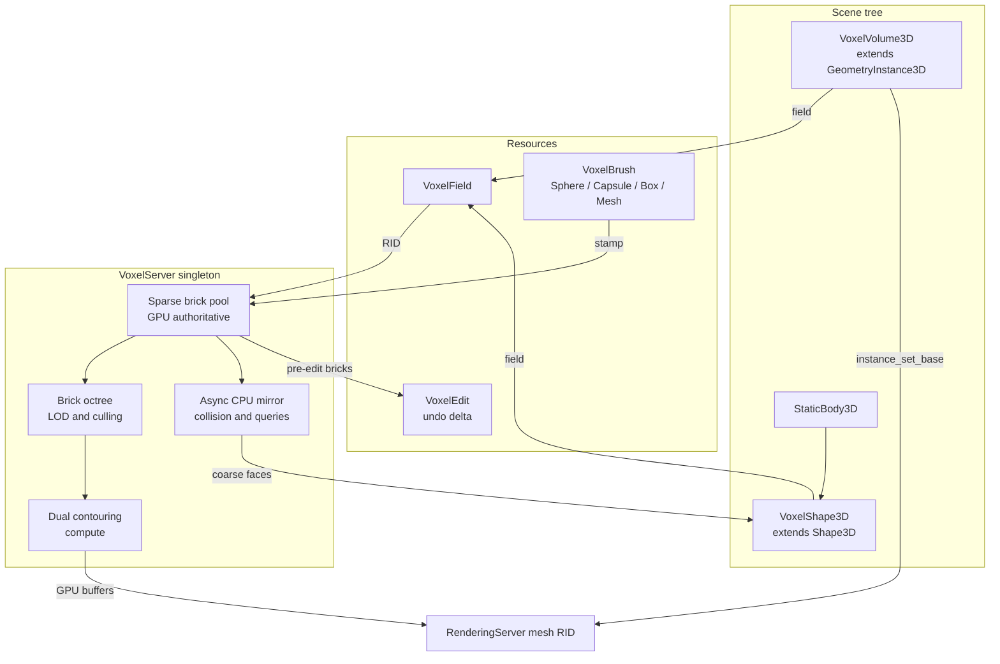
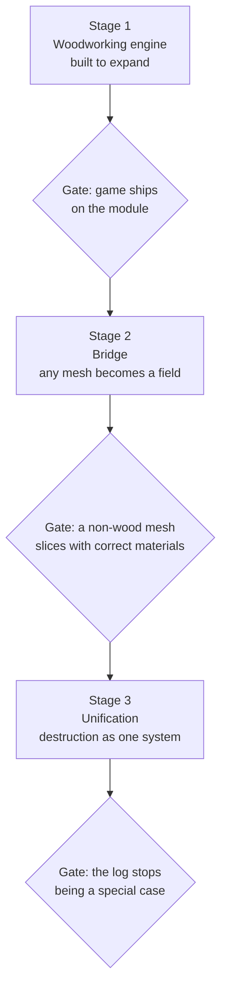
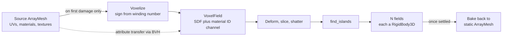

# Voxel Engine Module — Design Document

Engine-level sparse SDF volume system for Objectively Wrong, built as a first-class Godot
module inside a fork. No GDExtension. The goal is a feature that a Godot user would not be
able to distinguish from `GridMap`, `CSGShape3D`, or `MeshInstance3D` in look, feel, or
workflow.

---

## 1. Purpose and constraints

### What we are building

A signed distance field volume that can be sculpted at sub-millimeter resolution in real
time, rendered without CPU readback, collided against without cook cost, and edited both at
runtime from GDScript and at design time in the editor viewport.

### The one architectural mistake we are correcting

In the current project the CPU `PackedFloat32Array` in `scripts/volume/wood_volume.gd` is
the source of truth. Every other subsystem mirrors it. That single fact causes all of the
present problems:

- The GPU carve attempt had to read back, costing ~110 ms per stamp.
- The mesher must snapshot the whole grid (`_densities.duplicate()`) to hand it to a worker.
- Connectivity must scan the whole grid to find islands.
- Sub-millimeter voxels are impossible, because a dense 1440-cubed grid is 12 GB.

Every phase of this design moves ownership one step away from that array: GDScript loses it
to the engine, dense loses it to sparse bricks, and finally the CPU loses it to the GPU.

### Hard requirements

- Target voxel size 0.5 mm over a 0.72 x 0.38 x 0.38 m blank. That is 1440 x 760 x 760
  cells, so sparse storage is mandatory, not an optimization.
- Zero GPU readback on the render path.
- Sharp chisel facets and smooth polished curves must be visually distinguishable.
- Physics debris must still work, and physical detail must not be forced to match visual
  detail.
- The whole thing must be drivable from GDScript with no C++ knowledge required.

---

## 2. Design principles

These are the rules that keep the result from feeling like a patch job. Every decision below
traces back to one of them.

1. **Mirror the engine's trinity.** Godot is Servers, Resources, and Nodes. Data lives in a
   server behind RIDs. Resources are savable handles to that data. Nodes are thin scene tree
   adapters. Anything that does not fit this shape is a smell.
2. **Inherit, do not reinvent.** `VoxelVolume3D` extends `GeometryInstance3D` so it gets
   shadows, GI mode, visibility ranges, LOD bias, render layers, and material overrides for
   free. Collision goes through `Shape3D` so it works with every existing
   `CollisionObject3D`.
3. **Keep the fork diff minimal.** The module is a directory. The engine patches are a short,
   separable commit series. Rebasing onto upstream must never mean replaying twenty thousand
   lines.
4. **Everything discoverable.** Class docs in the editor help, icons in the Create Node
   dialog, project settings under a `voxel/` prefix, performance monitors in the debugger.
   These are cheap and they are the entire difference between a feature and a hack.
5. **Measure in-engine.** Custom `Performance` monitors from day one. The prior GPU attempt
   felt like an optimization and cost 110 ms. That must be impossible to miss again.

---

## 3. Architecture



The single most important consequence of this shape: because extraction output is registered
as a normal `RenderingServer` mesh RID and the node is a normal `GeometryInstance3D`, the
volume participates in the standard Forward+ pipeline. Shadow passes, depth prepass, SSAO,
SSIL, GI, and culling all work with no additional code. That is why the engine patch is
small.

---

## 4. Fork and repository layout

### Repository strategy

Fork `godotengine/godot`, branch `ow-4.7`. Maintain two clearly separated commit groups.

```
ow-4.7
├── core-patches/          (a short series, 6 to 8 files, rebased onto upstream)
│   ├── rendering: GPU-resident mesh surfaces + indirect draw
│   └── physics:   PhysicsServer3D SHAPE_VOXEL + Jolt custom shape
└── modules/voxel/         (one commit adding a directory, never conflicts)
```

Keeping the module as a self-contained directory means an upstream rebase only ever replays
the core patch series. If you later want to test against pristine upstream, the module moves
out to its own repository and builds with `scons custom_modules=../ow_modules` with no code
changes. Start in-tree for convenience; the option stays open.

### Module tree

```
modules/voxel/
├── config.py                       can_build, configure, get_doc_classes,
│                                   get_doc_path, get_icons_path
├── SCsub                           sources + GLSL_HEADER for compute shaders
├── register_types.h/.cpp           initialize/uninitialize per ModuleInitializationLevel
│
├── voxel_server.h/.cpp             singleton, RID owner, command queue, thread
├── voxel_server_default.h/.cpp     concrete backend
│
├── field/
│   ├── voxel_field.h/.cpp          Resource, handle to server RID
│   ├── brick_pool.h/.cpp           sparse allocation, apron, constant bricks
│   ├── brick_octree.h/.cpp         LOD hierarchy, occupancy summaries
│   ├── channels.h/.cpp             SDF + user channel formats
│   └── field_io.h/.cpp             ResourceFormatSaver/Loader for .voxelfield
│
├── ops/
│   ├── voxel_brush.h/.cpp          abstract Resource
│   ├── voxel_brush_sphere.h/.cpp   and capsule, box, mesh, texture
│   └── voxel_edit.h/.cpp           undo delta Resource
│
├── mesher/
│   ├── dual_contour_cpu.h/.cpp     reference implementation and oracle
│   ├── marching_cubes_cpu.h/.cpp   parity baseline, kept for validation
│   └── qef.h                       quadratic error function solver
│
├── gpu/
│   ├── voxel_gpu.h/.cpp            main RenderingDevice resources
│   ├── vx_stamp.glsl               brush application into brick pool
│   ├── vx_classify.glsl            active cell classification + prefix sum
│   ├── vx_contour.glsl             QEF solve, vertex emission
│   ├── vx_index.glsl               index emission + indirect draw args
│   └── vx_common_inc.glsl          shared brick addressing
│
├── scene/
│   ├── voxel_volume_3d.h/.cpp      GeometryInstance3D
│   └── voxel_shape_3d.h/.cpp       Shape3D
│
├── editor/
│   ├── voxel_editor_plugin.h/.cpp  toolbar, viewport sculpting, undo/redo
│   ├── voxel_volume_gizmo.h/.cpp   EditorNode3DGizmoPlugin
│   └── voxel_field_preview.h/.cpp  EditorResourcePreviewGenerator
│
├── tests/
│   └── test_voxel_field.h          doctest, runs under `godot --test`
│
├── doc_classes/*.xml               generated by --doctool, hand edited
└── icons/VoxelVolume3D.svg         and one per registered class
```

---

## 5. The class surface

Naming is unprefixed because that is what native feels like. The one collision risk is
Zylann's `godot_voxel` module, which uses `VoxelTool` and `VoxelBuffer`; those names are
avoided here. If you ever need both modules in one build, an `SDF` prefix is the escape hatch.

### 5.1 VoxelServer — the data owner

Follows the `RenderingServer` and `NavigationServer3D` pattern: an `Object` singleton
registered at `MODULE_INITIALIZATION_LEVEL_SERVERS`, owning everything behind RIDs, with a
`CommandQueueMT` marshaling mutations to a dedicated server thread.

```gdscript
## Low level access. Most code should use VoxelField instead.
var field_rid: RID = VoxelServer.field_create()
VoxelServer.field_set_bounds(field_rid, AABB(Vector3.ZERO, Vector3(0.72, 0.38, 0.38)))
VoxelServer.field_set_voxel_size(field_rid, 0.0005)
```

Exposed groups:

- `field_*` create, free, bounds, voxel size, channel setup, stamping, sampling, raycast
- `field_get_mesh(RID) -> RID` the `RenderingServer` mesh maintained by extraction
- `field_get_islands(RID)` connectivity, async with a completion signal
- `get_monitor(Monitor) -> float` brick count, GPU bytes, extract microseconds, triangles

Rationale: GDScript users never need this layer, but it exists for the same reason
`RenderingServer` exists. It makes the design honest, allows tooling, and is where all
thread safety lives.

### 5.2 VoxelField — the data Resource

A `Resource` holding an RID into `VoxelServer`, exactly as `Texture2D` holds an RID into
`RenderingServer`. Savable to a separate `.voxelfield` file via a custom
`ResourceFormatSaver`, Zstd compressed, storing only allocated bricks.

```gdscript
var field := VoxelField.new()
field.bounds = AABB(Vector3.ZERO, Vector3(0.72, 0.38, 0.38))
field.voxel_size = 0.0005

## Channels beyond SDF. These become vertex attributes on the extracted mesh.
field.add_channel(&"bark", VoxelField.FORMAT_UNORM8)
field.add_channel(&"polish", VoxelField.FORMAT_UNORM8)
field.add_channel(&"virgin", VoxelField.FORMAT_UNORM8)

## Fill the blank.
var blank := VoxelBrushCapsule.new()
blank.radius = 0.19
blank.height = 0.72
field.stamp(blank, Transform3D.IDENTITY, VoxelField.OP_UNION)
```

Signals: `changed`, `bounds_changed`, `islands_found(islands: Array[VoxelIsland])`.

The **channels** design replaces the current abuse of vertex `COLOR` channels in
`chunk_mesher.gd`, where `COLOR.r` is bark blend, `COLOR.g` is a displacement mask, and
`COLOR.a` is polish. Channels are declared data, they map cleanly onto `ARRAY_CUSTOM0` as
RGBA8, and the shader reads them as `CUSTOM0` instead of hijacking vertex color.

### 5.3 VoxelBrush — the operation Resource

Mirrors the `Shape3D` hierarchy, so it reads as familiar immediately.

```gdscript
VoxelBrush              # abstract, has strength and falloff curve
├── VoxelBrushSphere    # radius
├── VoxelBrushCapsule   # radius, height
├── VoxelBrushBox       # size, corner_radius
├── VoxelBrushMesh      # baked from an ArrayMesh into an SDF texture
└── VoxelBrushTexture   # a Texture3D used directly as an SDF
```

Operations, mirroring `CSGShape3D.Operation`:

- `OP_UNION` add material
- `OP_SUBTRACT` carve
- `OP_INTERSECT`
- `OP_SMOOTH` blur the SDF locally, the polish tool
- `OP_PAINT` write channels only, leave the SDF untouched

The key API for continuous strokes:

```gdscript
## One call replaces the swept stamp loop in workshop_carver._carve_toward_cursor.
## Spacing, dwell handling, and dirty region union all happen inside the engine.
field.stamp_path(brush, path_points, VoxelField.OP_SUBTRACT)
```

That single method removes the entire GDScript stamping loop, the `begin_stamp_batch` and
`end_stamp_batch_remesh` bookkeeping, and the `MAX_STAMPS_PER_SEGMENT` clamp. The engine
knows the brush footprint, so it computes optimal spacing itself.

### 5.4 VoxelVolume3D — the node

```cpp
class VoxelVolume3D : public GeometryInstance3D
```

Extending `GeometryInstance3D` rather than `Node3D` is the highest-leverage decision in this
document. It inherits, at zero cost:

`cast_shadow`, `gi_mode`, `gi_lightmap_scale`, `visibility_range_begin/end` with fade modes,
`lod_bias`, `transparency`, `extra_cull_margin`, `material_override`, `material_overlay`,
plus everything from `VisualInstance3D`: `layers`, `sorting_offset`, AABB culling.

Its own properties:

```gdscript
@export var field: VoxelField
@export var material: Material
@export var lod_screen_error_pixels: float = 1.0
@export var generate_collision: bool = true
@export var collision_voxel_multiplier: int = 4
```

Implementation is a handful of lines, because the heavy lifting is in the server:

```cpp
void VoxelVolume3D::_update_field() {
    if (field.is_valid()) {
        set_base(VoxelServer::get_singleton()->field_get_mesh(field->get_rid()));
    } else {
        set_base(RID());
    }
}

AABB VoxelVolume3D::get_aabb() const {
    return field.is_valid() ? field->get_bounds() : AABB();
}
```

The conservative field-bounds AABB is exact enough for culling a single workpiece and costs
nothing. A GPU-computed tight AABB can be read back asynchronously later if large scenes
ever need it.

### 5.5 VoxelShape3D — the collider

A `Shape3D` subclass, so it drops into `StaticBody3D`, `RigidBody3D`, `Area3D`, and every
existing physics query with no special casing.

```gdscript
var body := StaticBody3D.new()
var shape := VoxelShape3D.new()
shape.field = field
shape.voxel_multiplier = 4   ## collide at 2 mm while rendering at 0.5 mm
body.shape_owner_add_shape(body.create_shape_owner(body), shape)
```

Decoupling `voxel_multiplier` from visual resolution is essential. Cooking a
sub-millimeter concave trimesh for Jolt would be ruinous and pointless; nothing in the game
can feel the difference between 0.5 mm and 2 mm collision.

Two implementation stages, described in section 9.

### 5.6 VoxelEdit — undo as a first-class Resource

Brick-level copy on write. Before a stroke modifies a brick, if the brick's version predates
the current edit, its prior state is pushed to an undo arena. Cost is bounded by bricks
actually touched, not by field size.

```gdscript
var edit_id: int = field.begin_edit()
field.stamp_path(chisel, path, VoxelField.OP_SUBTRACT)
var edit: VoxelEdit = field.end_edit(edit_id)

edit.undo()
edit.redo()
```

The editor plugin wires this to `EditorUndoRedoManager`. Runtime code gets game-level undo
from the same mechanism, which is a genuine gameplay feature for a woodworking game where a
bad cut should be reversible.

---

## 6. Data structures

### 6.1 Sparse brick pool

- **Brick** 16-cubed cells of data, stored as 18-cubed with a one-cell apron. The apron is
  what allows hardware trilinear filtering and gradient computation across brick boundaries
  without neighbor lookups in the inner loop. Overhead is 42 percent of allocated bricks,
  which is trivial next to the savings from sparsity.
- **SDF format** `int16` normalized to a narrow band of a few voxels. Half the bandwidth of
  `float32` with no perceptible quality loss, and still filterable for LOD downsampling.
- **Constant bricks** slot 0 is all air, slot 1 is all solid. Uniform interior and exterior
  regions consume zero pool space. For a log this is the overwhelming majority of the volume.
- **Indirection** an `R32UI` 3D texture at brick resolution, so `bounds / 16`. For
  1440 x 760 x 760 that is 90 x 48 x 48 entries, about 830 KB. Negligible.
- **Pool residency** bricks are allocated on demand when a stamp or the initial fill causes
  a cell to straddle the isosurface. Capacity is a project setting with an eviction policy
  for bricks that have collapsed back to constant.

Expected active brick count at 0.5 mm for this blank: surface area is roughly 1.08 square
meters, which at 0.5 mm is about 4.3 million surface cells, so on the order of 2000 to 4000
active bricks. At 18-cubed int16 per channel that is roughly 47 MB for SDF plus channels.
Entirely comfortable.

### 6.2 Brick octree

Coarser levels store 2:1 downsampled SDF. Used for three things at once:

- **LOD** extraction level chosen per brick by projected screen-space error against
  `lod_screen_error_pixels`.
- **Occupancy summaries** each node records whether its subtree is all air, all solid, or
  mixed. This is what makes connectivity cheap.
- **Fast rejection** raycasts and brush footprint queries skip whole subtrees.

### 6.3 Connectivity for detach

Replaces the full-grid flood fill at `wood_volume.gd:1430`, which currently visits every
cell in the scan bounds. Instead, union-find over brick-level occupancy summaries, descending
into individual cells only for bricks the current stroke actually touched. Island results
carry an AABB and a brick list, so `extract_island()` can build a debris field without
touching the rest of the volume.

This also fixes a latent problem in `_spawn_debris` at `wood_volume.gd:1321`, which copies
component cells into temporary full-grid arrays. At sub-millimeter resolution that allocation
alone would be fatal.

---

## 7. Threading model

Three tiers, all using engine-native primitives.

- **Server thread.** One dedicated thread owned by `VoxelServer`, fed by `CommandQueueMT`
  from `core/templates/command_queue_mt.h`. Handles ordered field mutations. This is exactly
  how `RenderingServerDefault` and `NavigationServer3D` are built, so it will look familiar
  to any engine contributor. Falls back to inline execution when
  `OS::get_singleton()->can_use_threads()` is false or the caller is already the server
  thread.
- **Worker pool.** `WorkerThreadPool::get_singleton()->add_group_task()` for embarrassingly
  parallel brick work: CPU mirror updates, collision face generation, connectivity descent.
  Using the engine pool rather than private threads means we do not oversubscribe cores
  against resource loading.
- **Render thread.** All `RenderingDevice` work goes through
  `RenderingServer::call_on_render_thread(Callable)`. This is the sanctioned path to the main
  device, and it is the reason the GPU-authoritative design is possible at all: resources
  created on the main device can be shared with the renderer, whereas
  `create_local_rendering_device()` produces RIDs that can never cross over. The current
  `scripts/volume/gpu_volume_field.gd:46` uses the local device, which is why that approach
  was a dead end regardless of readback cost.

Worker count is exposed as `voxel/threads/worker_count`, with 0 meaning derive from
`OS::get_processor_count()`.

---

## 8. GPU pipeline and the renderer patch

### 8.1 Compute stages

Module shaders live in `modules/voxel/gpu/*.glsl` and are compiled into the binary by
`env.GLSL_HEADER()` in `SCsub`, following `modules/lightmapper_rd` exactly. Each produces a
`<name>.glsl.gen.h` containing a `ShaderRD` subclass. No runtime shader file loading, no
import step, no `.import` files to commit.

```python
# modules/voxel/SCsub
env_voxel = env_modules.Clone()
env_voxel.GLSL_HEADER("gpu/vx_stamp.glsl")
env_voxel.GLSL_HEADER("gpu/vx_classify.glsl")
env_voxel.GLSL_HEADER("gpu/vx_contour.glsl")
env_voxel.GLSL_HEADER("gpu/vx_index.glsl")
env_voxel.Depends(Glob("gpu/*.glsl.gen.h"), ["gpu/vx_common_inc.glsl", "#glsl_builders.py"])
env_voxel.add_source_files(env.modules_sources, "*.cpp")
```

Per stroke, dispatched over touched bricks only:

1. `vx_stamp` evaluate the brush SDF and composite into the brick pool. Allocates new bricks
   through a GPU free list with an atomic bump allocator.
2. `vx_classify` mark active cells, prefix sum to get vertex and index offsets.
3. `vx_contour` solve the QEF per active cell, write the vertex, compute the exact normal
   from the SDF gradient, pack channel data.
4. `vx_index` emit indices for active edges and write `draw_indirect` arguments.

Nothing reads back. The only readback in the entire system is the asynchronous CPU mirror
for collision and gameplay queries, described in section 9.

### 8.2 Why dual contouring

Marching cubes places vertices only on cube edges by linear interpolation, so it cannot
represent a feature sharper than one voxel at any resolution. Every chisel facet gets
rounded off permanently. For a game whose entire aesthetic is crisp cut versus polished
curve, that is not a micro-optimization, it is the difference between the two surface types
being distinguishable.

Dual contouring places one vertex per cell by minimizing a quadratic error function over the
tangent planes at edge crossings, which reconstructs sharp creases and corners, and emits
roughly a quarter the vertices with better triangle shape.

Three further consequences that matter here:

- **LOD comes free.** The octree formulation of dual contouring collapses nodes whose QEF
  residual is below a threshold, which gives adaptive simplification and crack-free LOD
  transitions from the same algorithm. Marching cubes needs Transvoxel bolted on for seams,
  and Transvoxel still does not give adaptive simplification.
- **Boundary seams are structurally impossible.** Vertex position depends only on the QEF of
  its own cell, which is identical computed from either side of a brick boundary. Duplicated
  boundary vertices land in exactly the same place, so there is no crack even without index
  sharing across bricks.
- **The tearing bug class disappears.** The current `COLOR.g` position-only bark mask in
  `chunk_mesher.gd` exists solely because marching cubes duplicates vertices per triangle and
  neighbors could disagree. With deterministic per-cell vertices there is nothing to
  disagree about.

The known weakness is that plain dual contouring can produce non-manifold and
self-intersecting output. Since these meshes feed collision, use the manifold variant, which
permits multiple vertices per ambiguous cell. The CPU marching cubes implementation is kept
in `mesher/marching_cubes_cpu.cpp` permanently as the correctness oracle to diff against.

### 8.3 Core patch: GPU-resident mesh surfaces

This is the only renderer change, and it is deliberately narrow. `RenderingDevice` already
exposes `draw_list_draw_indirect` as of 4.4, but it can only be used inside a caller-managed
draw list, outside the scene renderer, which means no shadows, no GI, and no scene lighting.
The patch teaches the existing mesh path to accept caller-owned GPU buffers instead.

Files touched:

- `servers/rendering/storage/mesh_storage.h`
  Add the abstract entry point:
  ```cpp
  virtual void mesh_add_surface_from_device_buffers(RID p_mesh, const DeviceSurfaceData &p_data) = 0;
  ```
- `servers/rendering/renderer_rd/storage_rd/mesh_storage.h` and `.cpp`
  Implement it. Construct a `Mesh::Surface` whose `vertex_buffer` and `index_buffer` are RIDs
  supplied by the caller, plus a new `RID indirect_buffer` and `bool indirect`. Add
  `bool owns_buffers = false` so `mesh_free` does not destroy memory the module still owns.
- `servers/rendering/renderer_rd/forward_clustered/render_forward_clustered.cpp`
  At the draw call site in the render list template, branch on `surface->indirect` and issue
  `draw_list_draw_indirect` instead of `draw_list_draw`. Because shadow passes and the depth
  prepass route through this same path, they get indirect drawing for free.
- `servers/rendering/rendering_server.h` and `.cpp`, `rendering_server_default.h`
  Pass-through plumbing.

Two implementation hazards worth stating up front, because both cause silent corruption
rather than a clean error:

1. **Barrier tracking.** `RenderingDeviceGraph` must be told the indirect buffer is consumed
   as `RESOURCE_USAGE_INDIRECT_BUFFER_READ`, mirroring what `compute_list_dispatch_indirect`
   already does. Without it the graph will not insert the barrier between the contour compute
   and the draw, and you get one-frame-stale or torn geometry that looks like a race in your
   own code.
2. **Vertex format must match exactly.** Godot 4 compresses vertex attributes by default,
   including octahedral-packed normals. The compute shader must emit the precise layout that
   `mesh_surface_make_offsets_from_format` describes for the flags you declare. The pragmatic
   path is to declare the uncompressed layout first, get it correct and visible, then move to
   the packed layout as a measured optimization.

Deliberately **not** patched: no new `VisualInstance3D` type, no new render pass, no
compositor effect, no changes to the shader compiler. The volume is a mesh instance whose
mesh happens to be maintained on the GPU.

---

## 9. Physics

### Stage one: no core patch

`VoxelShape3D` maps internally onto `PhysicsServer3D::SHAPE_CONCAVE_POLYGON`. The server
maintains a coarse CPU mirror of touched bricks at `voxel_multiplier` resolution, extracts
faces on the worker pool, and calls `shape_set_data`. Regions rebuild asynchronously; physics
trailing rendering by a frame or two is imperceptible and is the only remaining readback in
the system.

This gets working collision with zero engine surgery and is where the project should sit for
a long time.

### Stage two: SDF collision, core patch

Add `PhysicsServer3D::SHAPE_VOXEL` and a custom `JPH::Shape` in `modules/jolt_physics` that
ray-casts, point-tests, and shape-casts directly against the brick pool. No cook cost, exact
at full resolution, and updates are free because the shape reads live data.

Be clear-eyed about the cost: a custom Jolt shape requires implementing the support function,
`CastRay`, `CollidePoint`, `CollideSoftBodyVertices`, and registering entries in Jolt's
collision dispatch table for every shape pair you care about. It is well-trodden but it is
real work, and it extends a core enum, which is the most invasive patch in this document.
Defer it until stage one is measurably the bottleneck.

Debris keeps using `ConvexPolygonShape3D` hulls in both stages. Convex hulls are correct and
cheap for small chips, and the existing `WoodDebris` class needs no change beyond being fed
by `field.extract_island()`.

---

## 10. Making it feel native

This is the checklist that separates an engine feature from a modification. Every item is
cheap; skipping them is what makes forks feel wrong.

- **Class documentation.** `config.py` declares `get_doc_classes()` and `get_doc_path()`.
  Run `bin/godot --doctool .` to generate `modules/voxel/doc_classes/*.xml`, then write real
  descriptions for every class, method, property, signal, and enum value. These appear in the
  in-editor help exactly like built-in classes, and they are what makes the API
  self-teaching. Non-negotiable.
- **Icons.** One SVG per registered class in `modules/voxel/icons/`, named after the class.
  `VoxelVolume3D` then appears with a proper icon in the Create Node dialog and the scene
  tree, and `VoxelField` in the inspector.
- **Project settings.** Registered with `GLOBAL_DEF` and full `PropertyInfo` hints under a
  `voxel/` prefix, so they sit alongside `rendering/` and `physics/` in Project Settings:
  `voxel/memory/gpu_brick_pool_mb`, `voxel/threads/worker_count`,
  `voxel/extraction/algorithm`, `voxel/extraction/qef_threshold`,
  `voxel/collision/voxel_multiplier`, `voxel/lod/screen_error_pixels`,
  `voxel/debug/draw_brick_bounds`.
- **Performance monitors.** Register custom monitors so brick count, GPU bytes, stamp
  microseconds, extraction microseconds, and triangle count graph live in the debugger's
  Monitors tab. This is the in-engine answer to "measure or you are guessing," and it makes a
  regression like the 110 ms stamp impossible to overlook.
- **Editor gizmos.** An `EditorNode3DGizmoPlugin` drawing field bounds, and optionally brick
  bounds colored by LOD level when the debug setting is on.
- **In-editor sculpting.** The editor plugin adds a toolbar to
  `CONTAINER_SPATIAL_EDITOR_MENU` when a `VoxelVolume3D` is selected and implements
  `forward_3d_gui_input` so you can sculpt the blank directly in the viewport, with strokes
  pushed through `EditorUndoRedoManager` as `VoxelEdit` actions. This is the same interaction
  model as the `GridMap` and `TileMap` editors, and it is the single feature that will make
  this feel like it shipped with Godot.
- **Resource thumbnails.** An `EditorResourcePreviewGenerator` so `.voxelfield` files get
  previews in the FileSystem dock.
- **Unit tests.** `modules/voxel/tests/test_voxel_field.h` using doctest, picked up
  automatically into the module test aggregation and run by `bin/godot --test`. Cover brick
  allocation and eviction, stamp idempotence, QEF stability on degenerate configurations,
  connectivity correctness against a brute-force reference, and save/load round trips.
- **Headless benchmark.** A scene replaying fixed synthetic stroke paths under `--headless`,
  reporting the custom monitors, run on every commit and compared against the previous.

---

## 11. Build and workflow

```bash
git clone https://github.com/<you>/godot.git
cd godot
git checkout -b ow-4.7 4.7

# Editor build for development
scons platform=windows target=editor dev_build=yes -j$(nproc)

# Generate documentation stubs after adding or changing classes
bin/godot.windows.editor.x86_64.exe --doctool .

# Run module unit tests
bin/godot.windows.editor.x86_64.exe --test

# Export templates for shipping
scons platform=windows target=template_release
scons platform=windows target=template_debug
```

Point the project at the built editor binary. Export presets need the custom templates, which
is the one permanent workflow cost of forking, alongside losing the ability to ship on stock
Godot or the web export.

If the module ever moves out of tree, the only change is the build invocation:

```bash
scons platform=windows target=editor custom_modules=../ow_modules
```

---

## 12. Execution: three stages

Three stages, each with a hard exit gate. Stage 1 ships the game. Stage 2 prepares the ground
for arbitrary meshes without adding player-facing features. Stage 3 unifies them. Within a
stage, phases are ordered by dependency and each must pass its benchmark before the next
begins, because the data layout of every phase is baked into the following one.



---

### Stage 1 — The woodworking engine, built to expand

Phases 0 through 7 below. Stage 1 is finished when the game runs entirely on the module with
the GDScript volume deleted.

**"Built to expand" has to mean something checkable, or it means nothing.** These are the
eight invariants. Each is a test, not an intention, and each is far cheaper to hold now than
to retrofit in Stage 2.

1. **Domain neutrality.** The strings wood, bark, log, chisel, and polish appear nowhere in
   `modules/voxel/`. All woodworking specifics live in the game's shader, brush
   configuration, and material set. Enforce with a grep in CI.
2. **Material ID channel exists from Phase 1**, and extraction groups cells by it into
   separate mesh surfaces. The log needs only two values, so this looks like waste. It is not:
   retrofitting a channel the mesher must group by means rewriting extraction.
3. **N fields, always.** The server handles many concurrent fields and the test suite runs at
   least three from Phase 1. This is the invariant most likely to be violated silently,
   because a game with one log will happily accumulate single-field assumptions in globals,
   static state, one uniform set, and one indirect buffer.
4. **Field-local coordinates only.** Nothing assumes a field sits at the world origin or is
   axis aligned. The current `wood_volume.gd` effectively does assume this, since the log is
   at origin. Destructible props each carry their own transform.
5. **`extract_island` returns a real independent `VoxelField`**, not a one-off debris mesh.
   Today `_spawn_debris` builds a mesh directly. If islands come back as fields, then slicing
   a crate in half and knocking a chip off a log are literally the same code path.
6. **Extraction is a swappable Resource.** Marching cubes and dual contouring are
   interchangeable implementations behind one interface, so Phase 3 is a swap rather than a
   rewrite, and specialized meshers stay possible later.
7. **`VoxelBrushMesh` exists in Phase 1**, even if nothing uses it. Mesh to SDF must not be a
   later bolt-on, because it is the entire entry point for Stage 2.
8. **Brick pool is a shared arena** from Phase 2, never one pool per field.

#### Phase 0 — Fork and skeleton

Fork, branch, module directory with `config.py`, `SCsub`, `register_types.cpp` registering a
`VoxelServer` singleton with one trivial method. Prove the build, prove the singleton is
visible from GDScript, prove `--doctool` and `--test` work. Nothing else.

#### Phase 1 — The trinity at parity

`VoxelServer`, `VoxelField`, `VoxelVolume3D`, `VoxelShape3D`, `VoxelBrush` hierarchy. Dense
CPU storage, CPU marching cubes, output through a normal `ArrayMesh`. **No core patches.**
Feature parity with the current GDScript implementation, at roughly thirty times the speed
from language alone.

Also in this phase, because they are cheap and they set the tone: docs XML, icons, project
settings, performance monitors, unit tests, benchmark harness. Invariants 1 through 7 land
here.

At the end of Phase 1 the game runs entirely on the module and
`scripts/volume/wood_volume.gd`, `chunk_mesher.gd`, `mc_tables.gd`, and `gpu_volume_field.gd`
are deleted.

#### Phase 2 — Sparse

Brick pool as a shared arena, with apron and constant bricks, brick octree with occupancy
summaries, `.voxelfield` save format, hierarchical connectivity, sparse island extraction.
Sub-millimeter becomes representable. Still CPU, still marching cubes, so any regression is
unambiguously the storage change.

#### Phase 3 — Dual contouring and LOD

Manifold octree dual contouring on the CPU with QEF, adaptive simplification, LOD selection
by screen error. Validate against the retained marching cubes implementation. This is where
chisel facets become sharp and where the shader stops needing displacement.

#### Phase 4 — GPU authoritative

Brick pool moves to the main `RenderingDevice` via `call_on_render_thread`. `vx_stamp`
compute replaces CPU stamping. The GPU becomes the source of truth. Asynchronous CPU mirror
feeds collision and queries. Extraction still runs on the CPU from the mirror, so this phase
is isolated from the renderer patch.

#### Phase 5 — GPU extraction and the renderer patch

`vx_classify`, `vx_contour`, `vx_index` compute stages. The core patch for GPU-resident mesh
surfaces and indirect draw. Zero readback on the render path. This is the endgame for
rendering.

#### Phase 6 — SDF collision

`PhysicsServer3D::SHAPE_VOXEL` and the custom Jolt shape. Only if the coarse concave approach
from Phase 1 is measurably limiting.

#### Phase 7 — Editor sculpting

Viewport sculpting with undo and redo, gizmos, resource previews, import from external SDF or
mesh sources.

**Exit gate.** The woodworking game is playable and shipping on the fork, the benchmark
harness is green, and all eight invariants have passing tests.

---

### Stage 2 — Bridge

No new player-facing features. This stage makes an arbitrary `Mesh` become a `VoxelField` that
still looks like itself, and it is deliberately small because Stage 1 did the hard part.

**Start by auditing, not building.** The first task is a conformance suite that tries to break
the eight invariants: run twenty concurrent fields, place them at random non-identity
transforms, round-trip material IDs through save and load, swap the mesher at runtime, grep
for domain leakage. Whatever leaked in Stage 1 hurts here, and it is far cheaper to find it
before anything is built on top.

Then, in order:

1. **Mesh voxelization.** `VoxelField.from_mesh(mesh, voxel_size)`. Use a generalized winding
   number for the sign, not ray parity or an outside flood fill, both of which leak through
   the holes that real game meshes always have.
2. **Attribute transfer.** A triangle BVH over the source mesh with closest-point queries
   returning UV, tangent frame, and surface index, baked into channels during voxelization.
   Note that Embree is already vendored in the fork for `modules/raycast`, so the BVH may be
   free; verify that Godot's reduced Embree build retains point queries, and fall back to a
   small custom BVH if not.
3. **Material sets.** A `VoxelMaterialSet` resource mapping material IDs to materials, with
   one reserved interior ID. Extraction emits one surface per present ID.
4. **Field lifecycle.** Lazy activation, so an undamaged prop renders as its original
   `ArrayMesh` with full UVs and allocates no field at all. Bake-back, so a settled piece
   becomes a static `ArrayMesh` plus collision shape and frees its bricks. Budget and eviction
   under memory pressure.

**Exit gate.** An arbitrary imported mesh, not a log, voxelizes and slices in two, where the
outside still carries its original texturing and the cut face shows the interior material.
Memory returns to baseline after the pieces settle.

---

### Stage 3 — Unification

1. **Slicing API.** `field.slice(plane_or_brush)` returning the resulting fields, built on the
   one-voxel-thick carve plus connectivity from Stage 1.
2. **Voronoi fracture.** The compute pass from section 15, with site density biased toward the
   impact point.
3. **Piece physics.** Convex hull for small fragments, convex decomposition for large ones, or
   the `VoxelShape3D` SDF shape from Phase 6 where exactness matters. Mass, center of mass,
   and inertia tensor summed from voxels.
4. **`VoxelDestructible3D extends VoxelVolume3D`.** The node a user actually drops in a scene:
   holds a source mesh, voxelizes on first damage, fractures, spawns pieces, bakes back when
   settled. All of the lifecycle in one place.
5. **Editor workflow.** Drop a mesh, get a destructible. Preview fracture patterns in the
   viewport before running the game.

**Exit gate, and the real proof.** The wood log stops being a special case. It becomes a
`VoxelDestructible3D` carrying a wood material set and carving brushes, with no code path in
the module that exists only for it. If the log still needs special handling at the end of
Stage 3, the generalization was bolted on rather than real, and invariant 1 was violated
somewhere upstream.

---

## 13. Migration map for the existing project

- `scripts/volume/wood_volume.gd` deleted. Its orchestration collapses into the node and
  server. The 1688 lines have no successor because most of them exist to work around GDScript
  and dense storage.
- `scripts/volume/chunk_mesher.gd`, `mc_tables.gd`, `gpu_volume_field.gd`,
  `shaders/volume/*.glsl`, and the whole `native/ow_volume/` scaffold deleted.
- `scripts/tools/rough_chisel.gd` becomes a `VoxelBrushSphere` plus `OP_SUBTRACT`.
- `scripts/tools/polish_tool.gd` becomes `OP_SMOOTH` plus `OP_PAINT` on the polish channel.
- `scripts/tools/tool_base.gd` keeps its shape, but `apply()` calls
  `field.stamp(brush, xform, op)`.
- `scripts/workshop/workshop_carver.gd` loses `_carve_toward_cursor`'s stamp sweep,
  `STAMP_SPACING_FACTOR`, `MAX_STAMPS_PER_SEGMENT`, `REMESH_CHUNK_BUDGET`, the batch flags,
  and every `remesh_*` and `poll_background_work` call. What remains is input handling and
  one `field.stamp_path()`.
- `scripts/volume/wood_debris.gd` survives unchanged, fed by `field.extract_island()`.
- `scenes/logs/cut_log.tscn` root becomes a `VoxelVolume3D` with a `VoxelField` sub-resource.
- `assets/materials/wood_log.gdshader` is rewritten: triplanar projection with the grain axis
  aligned to the log's local X, channel data read from `CUSTOM0`, exact normals from the SDF
  gradient. Deleted from it: all vertex displacement, the height sampling, the `atan` mantle
  UV, the `COLOR.g` displacement mask, and `generate_tangents` dependence. At 0.5 mm voxels
  bark is real geometry, so the entire apparatus that faked it is unnecessary. The tearing,
  seam, and liquid-smearing bugs are not fixed by this, they become unrepresentable.

---

## 14. Relationship to Zylann's godot_voxel

[Zylann/godot_voxel](https://github.com/Zylann/godot_voxel) is the mature, MIT licensed voxel
module for Godot, at five thousand commits. It should be read closely and harvested
selectively, but it cannot be the foundation for this project. Both halves of that sentence
matter.

### What it validates

Zylann independently arrived at the same architecture proposed in section 3: an engine
singleton (`VoxelEngine`), voxel data as a Resource with typed channels (`VoxelBuffer`), an
operations abstraction with a mode plus shape methods (`VoxelTool` with `do_sphere`, `do_box`,
`stamp_sdf`), swappable meshers as Resources, scene nodes as thin adapters, and an editor
plugin. That convergence is meaningful: the trinity design in this document is not
speculative, it is the shape this problem takes in Godot.

### What to harvest

- **`VoxelMeshSDF` and `stamp_sdf`.** Baking an `ArrayMesh` into an SDF brush is already
  solved. This is `VoxelBrushMesh` from section 5.3, and it is worth more here than it first
  appears: every real chisel, gouge, and router profile becomes a mesh baked once and stamped.
- **Module scaffolding.** `config.py`, `SCsub` conventions, doc XML generation, icon layout,
  the `--test` harness, multi-platform CI. Months of unglamorous work, already correct.
- **The channel and depth system.** 8, 16, and 32 bit channels with fixed point or float
  interpretation, plus uniform compression for constant blocks. That is section 6.1's brick
  format, already designed and shipped.
- **The task system in `engine/` and the block map in `storage/`.** Read both before writing
  the equivalents.
- **Hard-won artifact knowledge.** Issue 714 documents that Transvoxel produces slivers that
  make Jolt unhappy, and that the `edge_clamp_margin` workaround causes visible protruding
  geometry under flat shading. Dual contouring has its own sliver pathology. Read that thread
  before debugging your own.

### Why it cannot be the foundation

Three disqualifying facts, all from the project's own documentation and maintainer.

1. **No sharp features, by design and by explicit decision.** Zylann on issue 109: "MC, DMC,
   Transvoxel do not support sharp edges. You need an algorithm that does, such as dual
   contouring and variations." He declined to implement one: "I considered implementing MDC,
   but decided to spend my time on other projects." Dual contouring has been an open
   enhancement since 2021. For a game whose entire aesthetic is crisp cut versus polished
   curve, the mesher is the one component that cannot be inherited.
2. **GPU support does not cover editing.** The GPU path exists only for detail normalmap
   baking, requires `VoxelGeneratorGraph`, and the documentation states plainly that "GPU
   normalmaps currently don't support edited voxels. Edited areas will fallback using the
   CPU." There is no GPU resident storage, no GPU meshing, and no indirect draw. Phases 4 and
   5 would have to be built from scratch regardless, and those are exactly the phases that
   replace his storage layer and his mesher.
3. **The domain is inverted.** `VoxelTerrain`, `VoxelLodTerrain`, `VoxelViewer`, streams, and
   `VoxelInstancer` all assume a large world paged around a moving viewer, with LOD driven by
   viewer distance. This project is one 0.72 meter object, entirely on screen, at extreme
   resolution, under continuous modification. LOD here has to be screen space error on a
   single workpiece.

Note also that `VoxelBuffer` is documented as dense, with "no sparse optimization of space."
Sparsity in his system lives one level up in the block map, which is the right idea, but it is
CPU resident and built for streaming rather than for a GPU brick pool.

### The one way it could shorten the path

Before committing years to engine work, consider prototyping the game on it as is, at two to
five millimeters with Transvoxel. Chisel marks would be visibly rounded and it could never
ship that way, but you would learn whether swept stroke carving with physics debris is
actually fun, which is the only question that makes the rest of this document worth executing.
That is cheap de-risking and it is the strongest argument for touching the module at all.

### Naming

Harvest by reading and rewriting, never by linking. Vendoring his module alongside this one
collides on `VoxelBuffer`, `VoxelTool`, `VoxelEngine`, and every `VoxelMesher*`. The names
chosen in section 5 avoid his current set, but that only holds while the two are never in the
same build.

---

## 15. Generalization: arbitrary destructible meshes

Load any `Mesh` into a voxel node, then deform, slice, or shatter it into pieces. This is
possible, and roughly 70 percent of it is already built by Phase 5, because a wood log being
carved into chips and a crate being split in half are the same operation at different scales.



### What is already free

- **Deformation** is `stamp` with any brush and any operation. Done in Phase 1.
- **Slicing** is a plane brush one voxel thick, followed by connectivity. At 0.5 mm the
  removed sliver is invisible, so no special topological split is needed. Done in Phase 2.
- **Shattering into pieces** is `find_islands` plus `extract_island` per piece, which is
  literally the existing wood debris path. Done in Phase 2.
- **Mesh voxelization** is `VoxelBrushMesh` used as a fill instead of a carve. Already in the
  brush hierarchy in section 5.3.
- **Exact mass properties.** Volume, center of mass, and the inertia tensor come from summing
  voxels, which is both cheaper and more accurate than deriving them from a mesh. Free.

### The one genuinely hard problem

A mesh is not just geometry. It carries a UV layout, several material surfaces, tangent
frames, and sometimes skinning. A round trip through a distance field destroys all of it and
hands back positions and normals. That, not the code, is why almost nobody ships naive runtime
mesh voxelization.

The answer is to stop trying to preserve everything and instead split the surface into two
populations:

- **Exterior surfaces**, which were part of the original mesh. For each generated vertex, find
  the closest point on the source mesh through a BVH and copy its UV, tangent frame, and
  material index. Undamaged regions then look pixel identical to the original asset.
- **Interior surfaces**, newly exposed by a cut or a fracture. These get a dedicated interior
  material and triplanar projection, needing no UVs at all.

This is what real destruction systems do, and it is also what the eye expects: the inside of a
broken crate should be splintered raw wood, not stretched exterior paint.

Implementation cost is one extra channel. Bake a **material ID** channel during voxelization,
seeded from the source mesh surface index near the boundary and set to the interior ID
everywhere else. Cutting simply reveals what was already stored. The channel system from
section 5.2 needs no changes, and the extracted mesh becomes multi surface by grouping cells
by material ID.

### Voronoi shattering in one compute pass

Worth calling out because the value to effort ratio is extreme. Scatter N sites inside the
field, biased in density toward the impact point. For each voxel find the nearest and second
nearest site; if the difference between those distances is under one voxel, that cell is a cell
boundary, so carve it. Run connectivity. You now have N pieces with plausible fracture shapes.

That is roughly twenty lines of GLSL on top of the Phase 4 stamping infrastructure and it
delivers full runtime Voronoi destruction with impact directionality.

### What must be decided in Stage 1 to keep this reachable

Nothing here needs building early, but several choices are expensive to reverse. They are the
eight expansion invariants in section 12, and they live there rather than being restated here so
there is exactly one authoritative list. The four that exist specifically to make this section
possible are domain neutrality, the material ID channel, `extract_island` returning real fields,
and the shared brick arena.

### Lifecycle, which is what separates a demo from something shippable

- **Lazy activation.** An undamaged object renders as its original `ArrayMesh` with full UVs
  and materials, and allocates no field at all. Voxelization happens on first damage. Without
  this, a scene of destructibles pays for detail nobody ever sees.
- **Bake back.** Once a piece has settled and stopped changing, extract a final `ArrayMesh`
  plus collision shape, then free its field and bricks. Otherwise GPU memory grows for the
  whole play session.
- **Budget.** Cap simultaneously active fields, and degrade to coarser LOD or fewer fracture
  pieces under pressure rather than stalling.

### What will never work well

Be honest about the boundary. Distance fields represent solid volumes. Thin and non
volumetric geometry is the classic failure mode and no resolution fixes it economically:
cloth, foliage, hair, chain links, wires, and blade edges thinner than a couple of voxels will
either vanish or bloat into blobs. This system is for crates, walls, rocks, furniture, statues,
vehicle panels, and logs. Keep everything else on conventional meshes.

Non watertight source meshes are survivable but need care: use a generalized winding number
for the sign rather than ray parity or an outside flood fill, both of which leak through holes.

### Effort, honestly

Stages 2 and 3 together are roughly 20 to 30 percent of Stage 1, concentrated in two places: the
BVH attribute transfer, and the multi object lifecycle above. Everything else is reuse.

The strategic caution matters more than the estimate. Generalizing to arbitrary destructible
meshes is a real scope multiplier and a classic way that ambitious engine projects die before
shipping anything. Design for it now, since that is nearly free, and build it only after the
woodworking game actually works.

---

## 16. Risks

- **Rebase burden is permanent.** Every upstream 4.x release means replaying the core patch
  series. Keeping that series to six to eight files in two subsystems is the entire mitigation
  strategy, and it is why the module must never leak into core directories.
- **No stock Godot, ever.** Custom export templates for every platform. No web export unless
  you also maintain the GLES3 path, which has no compute and would need a separate CPU
  extraction fallback.
- **Manifold dual contouring is genuinely hard.** QEF conditioning on thin and degenerate
  features is where implementations break. The retained CPU marching cubes oracle and unit
  tests on degenerate configurations are not optional.
- **Vertex format drift.** Upstream changes to Godot's vertex compression will silently break
  the compute shader's output layout. Pin a test that round-trips a known mesh through the
  device-buffer path and compares against the CPU path.
- **GPU brick pool exhaustion.** Needs a real eviction policy and a graceful degradation path
  to coarser LOD rather than a crash or visible popping when a player carves far more surface
  area than budgeted.
- **The custom Jolt shape extends a core enum.** This is the most invasive patch proposed and
  the most likely to conflict on rebase. It is correctly last.

---

## 17. Summary

The whole design reduces to three sentences. Data lives in a server behind RIDs, because that
is what Godot does. Storage is sparse and GPU-authoritative, because sub-millimeter detail is
impossible otherwise and readback is what killed the last attempt. Rendering reuses the
existing mesh instance path through one narrow patch, because that is how you get shadows,
GI, culling, and LOD for free instead of reimplementing them badly.

Everything else in this document is consequence.
